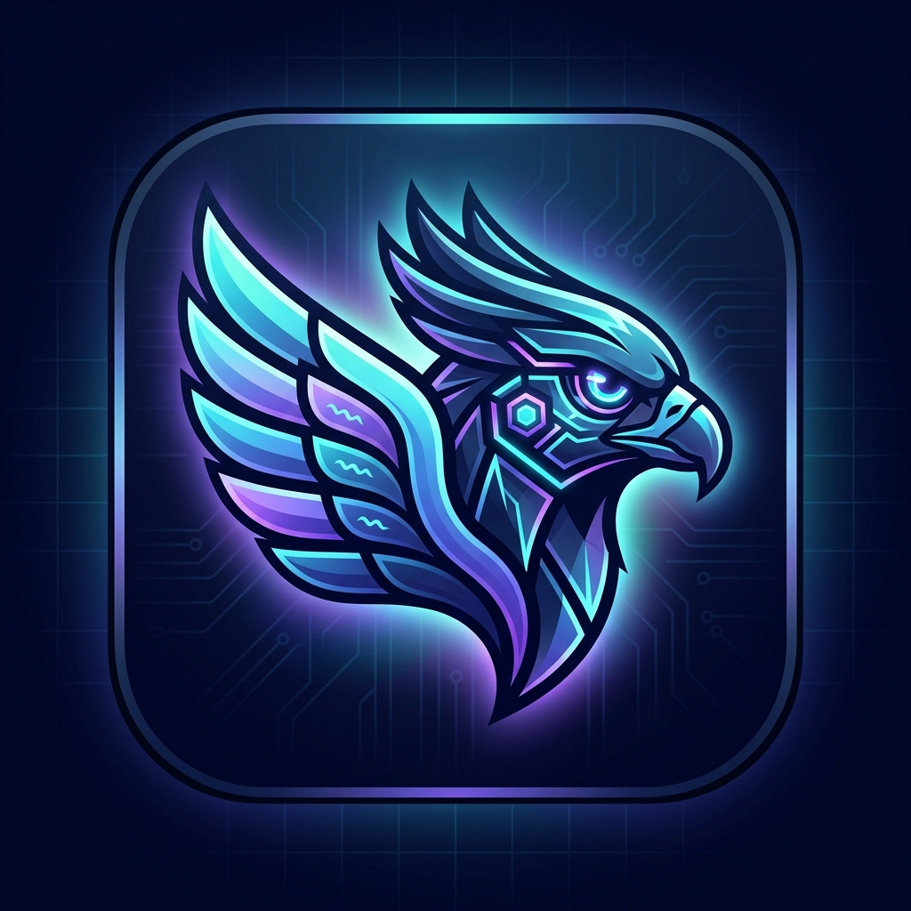
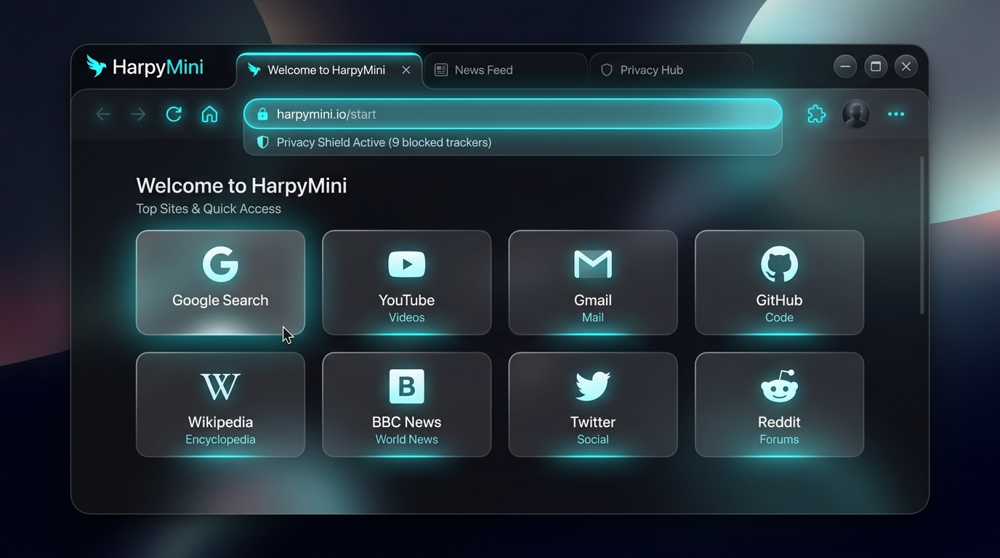
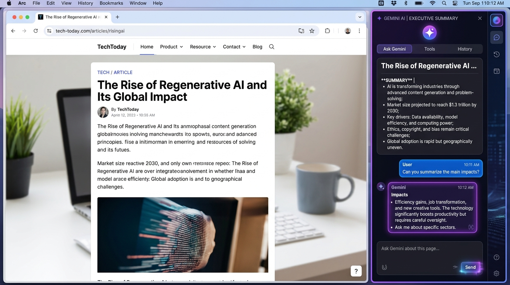
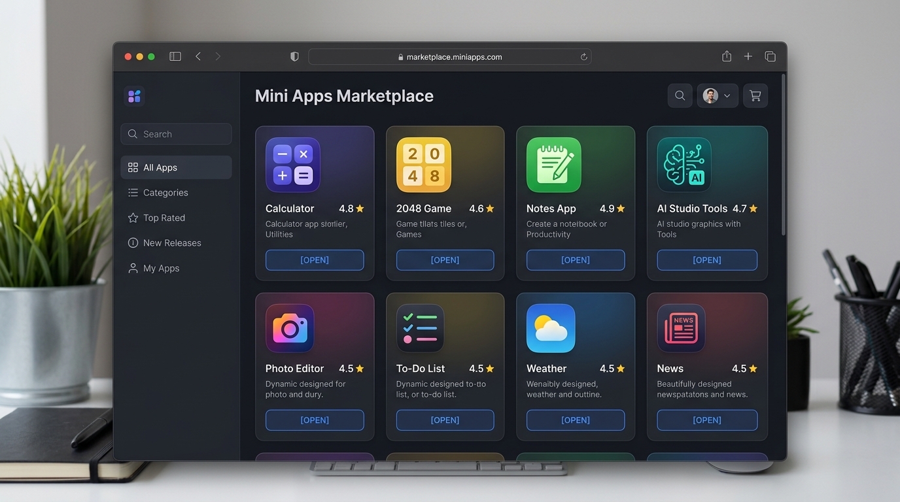
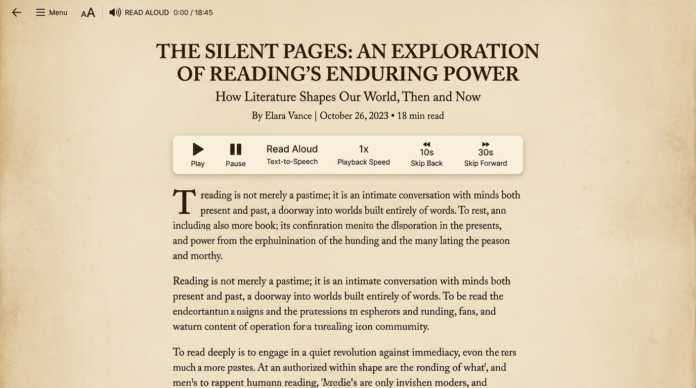

# 🦅 HarpyMini Browser

<p align="center">
  
</p>

<p align="center">
  <strong>Fast, Privacy-Focused & AI-Powered Web Browser with Built-in Mini Apps Market (মিনি অ্যাপস বাজার)</strong>
</p>

<p align="center">
  
  
  
  
  
  
</p>



---

## 📸 অ্যাপের স্ক্রিনশট গ্যালারি (Visual Showcase)

| 🏠 HarpyMini হোম ও ওমনিবার | 🤖 জেমিনাই এআই সহকারী |
|:---:|:---:|
|  |  |
| *গ্লাস মরফিজম ওমনিবার, স্পিড ডায়াল ও শিল্ড* | *আর্টিকেল সামারি, এআই প্রশ্নোত্তর ও চ্যাট* |

| 🛍️ মিনি অ্যাপস বাজার (Mini Apps Market) | 📖 ডিস্ট্রাকশন-ফ্রি রিডার মোড ও TTS |
|:---:|:---:|
|  |  |
| *জিরো-ইনস্টল গেমস, ক্যালকুলেটর ও এআই টুলস* | *সেপিয়া পেপার বুক থিম ও টেক্সট-টু-স্পিচ* |

---

## 📖 প্রজেক্ট ওভারভিউ (Overview)

**HarpyMini Browser** হলো একটি আধুনিক, দ্রুতগতির, প্রাইভেসি-ফার্স্ট এবং কৃত্রিম বুদ্ধিমত্তা (AI) চালিত ওয়েব ব্রাউজার। এটি ব্যবহারকারীদের নিরাপদ ও দ্রুত ব্রাউজিং অভিজ্ঞতার পাশাপাশি **WeChat Mini Programs বা Google Play Store-এর মতো একটি বিল্ট-ইন "মিনি অ্যাপস বাজার" (Mini Apps Marketplace)** প্রদান করে।

HarpyMini শুধুমাত্র একটি সাধারণ ব্রাউজার নয়—এটি একটি অল-ইন-ওয়ান প্ল্যাটফর্ম যা ওয়েব ব্রাউজার, ডেস্কটপ সফটওয়্যার (.exe), এআই অ্যাসিস্ট্যান্ট এবং জিরো-ইনস্টল মিনি অ্যাপস ইকোসিস্টেমকে একত্রিত করে।

---

## ✨ প্রধান ফিচারসমূহ (Key Features)

### 🧠 ১. এআই-পাওয়ার্ড স্মার্ট টুলস (AI-Powered Tools)
* **HarpyMini AI Assistant:** অ্যাক্টিভ ওয়েব পেজের কনটেন্টের ওপর ভিত্তি করে রিয়েল-টাইম প্রশ্নের উত্তর দেয়। এতে রয়েছে প্রম্পট শর্টকাট (*"৩টি মূল পয়েন্ট"*, *"সহজ ভাষায় বুঝাও"*, *"বিপরীত যুক্তি বা সীমাবদ্ধতা"* ইত্যাদি)।
* **১-ক্লিক পেজ সামারাইজেশন:** যেকোনো বড় আর্টিকেলের এক্সিকিউটিভ সামারি (TL;DR), গুরুত্বপূর্ণ পয়েন্ট এবং কতটুকু পড়ার সময় বেঁচেছে তার হিসাব প্রদান করে।
* **রিডার মোড (Reader Mode):** অপ্রয়োজনীয় বিজ্ঞাপন, ট্র্যাকার ও মেনু বাদ দিয়ে পরিষ্কার রিডিং ভিউ। ৪টি থিম (*ডার্ক স্লেট*, *সেপিয়া পেপার*, *OLED ব্ল্যাক*, *লাইট*) এবং ফন্ট কাস্টমাইজেশন।
* **টেক্সট-টু-স্পিচ (Read Aloud):** যেকোনো পেজ বা আর্টিকেল নিজে না পড়ে স্পিচ সিন্থেসিস দিয়ে এক ক্লিকে অডিও আকারে শোনার সুবিধা।
* **ভয়েস ব্রাউজিং (Voice Commands):** মুখে বললেই ব্রাউজার স্বয়ংক্রিয়ভাবে নেভিগেশন ও সার্চ পরিচালনা করে (*"Go to Wikipedia"*, *"Summarize this page"*, *"Open Apps Market"* ইত্যাদি)।

---

### 🛍️ ২. মিনি অ্যাপস বাজার (Mini Apps Marketplace)
যেকোনো কাজের জন্য ভারী কোনো সফটওয়্যার ফোনে বা পিসিতে ইনস্টল করার প্রয়োজন নেই! সরাসরি ব্রাউজারের ভেতর থেকে এক ক্লিকে মিনি অ্যাপস সার্চ করে চালানো যায়:

* 🧮 **Scientific Calculator:** সায়েন্টিফিক গণিত ও ক্যালকুলেশন হিস্ট্রি মেমোরি।
* ✅ **Smart To-Do Planner:** দৈনিক কাজের তালিকা, চেকলিস্ট ও প্রায়োরিটি ট্র্যাকার।
* 🎮 **2048 Puzzle Game:** ক্লাসিক লাইটওয়েট ব্রেইন টিজার গেম।
* 🤖 **AI Prompt & Idea Studio:** যেকোনো লেখা, কোডিং বা বিজনেস প্ল্যান উন্নত করার এআই স্টুডিও।
* ⚡ **Broadband Speed Test:** রিয়েল-টাইম পিং ল্যাটেন্সি ও ইন্টারনেট স্পিড মিটার।
* 📝 **Markdown Scratchpad:** স্বয়ংক্রিয়ভাবে সেভ হওয়া দ্রুত নোট নেওয়ার প্যাড।
* 🔄 **Universal Converter:** ডাটা মেমোরি (MB/GB), দৈর্ঘ্য, তাপমাত্রা ও কারেন্সি রূপান্তর।
* 📱 **QR Studio:** ক্যামেরা দিয়ে কিউআর স্ক্যান এবং লিংক শেয়ারের কিউআর জেনারেটর।
* 🪙 **Crypto Tracker:** বিটকয়েন, ইথেরিয়াম ও সোলানার লাইভ মার্কেট রেট ও গ্যাস ফি।
* ➕ **Custom App Submissions:** ব্যবহারকারী যেকোনো ওয়েব অ্যাপ্লিকেশনের লিংক দিয়ে বাজারে নতুন মিনি অ্যাপ যুক্ত করতে পারেন!

---

### 🔐 ৩. প্রাইভেসি ও জিরো-নলেজ সিকিউরিটি (Privacy & Security)
* **ক্লায়েন্ট-সাইড AES-GCM এনক্রিপ্টেড পাসওয়ার্ড ভল্ট:**
  * ব্রাউজারের কোনো পাসওয়ার্ড বা মাস্টার পাসওয়ার্ড রিমোট সার্ভারে প্লেইন টেক্সট হিসেবে যায় না।
  * Web Crypto API এবং PBKDF2 (১,০০,০০০ রাউন্ড) দিয়ে এনক্রিপ্ট হয়ে ক্লাউডে সংরক্ষিত থাকে।
  * স্ট্রং পাসওয়ার্ড জেনারেটর, ১-ক্লিক কপি ও ভল্ট অটো-লক ফিচার।
* **ডাটা সেভার ও অ্যান্টি-ট্র্যাকার শিল্ড (Harpy Shield):**
  * তৃতীয় পক্ষের ট্র্যাকিং স্ক্রিপ্ট, অ্যানালিটিক্স বীকন ও ভারী মিডিয়া স্বয়ংক্রিয়ভাবে ব্লক করে।
  * কতটুকু মেগাবাইট ডাটা সেভ হয়েছে এবং কতগুলো ট্র্যাকার ব্লক হয়েছে তা লাইভ ড্যাশবোর্ডে দেখা যায়।
* **ইনকগনিটো মোড (Incognito Stealth Browsing):**
  * কোনো ব্রাউজিং হিস্ট্রি, কুকি বা সাইট ডাটা সংরক্ষণ না করে সম্পূর্ণ ব্যক্তিগতভাবে ব্রাউজ করার সুবিধা।

---

### 🚀 ৪. ক্লাউড সিঙ্ক ও অফলাইন রিডিং (Cloud Sync & Offline)
* **Firebase Cloud Sync:** গুগল অ্যাকাউন্ট দিয়ে সাইন-ইন করে বুকমার্ক, হিস্ট্রি, এনক্রিপ্টেড ভল্ট এবং সেটিংস যেকোনো ডিভাইসে সিঙ্ক করার সুবিধা।
* **অফলাইন রিডিং ভল্ট:** যেকোনো ওয়েব পেজ বা ডকুমেন্ট ইন্টারনেট ছাড়াই পরবর্তীতে পড়ার জন্য অফলাইনে সেভ করে রাখা যায়।
* **Web3 Wallet UI:** ডিসেন্ট্রালাইজড ওয়েব ও dApp কানেকশন ব্রিজ সমৃদ্ধ ওয়ালেট ইন্টারফেস।

---

### 🖥️ ৫. ডেস্কটপ সংস্করণ (Electron + Chromium Engine)
এই ব্রাউজারটিকে **Brave Browser বা Google Chrome-এর মতো একটি আসল ডেস্কটপ সফটওয়্যার (`.exe` বা `.dmg`)** হিসেবে প্যাকেজ করার সম্পূর্ণ আর্কিটেকচার যুক্ত করা আছে:
* **জিরো ফ্রেম ব্লকিং:** ইউটিউব, গুগল, ফেসবুকসহ যেকোনো সাইট কোনো বাধা ছাড়াই সরাসরি লোড হয়।
* **নেটিভ ক্রোমিয়াম ইঞ্জিন:** রিয়েল Chromium নেটওয়ার্ক ইন্টারসেপ্টর দ্বারা ট্র্যাকার ও বিজ্ঞাপন ব্লক হয়।

---

## 🛠️ টেক স্ট্যাক (Tech Stack)

| কম্পোনেন্ট | প্রযুক্তি | বিবরণ |
| :--- | :--- | :--- |
| **Frontend Framework** | React 19 + TypeScript + Vite | দ্রুতগতির রিঅ্যাক্টিভ ওমনিবার, ট্যাব ও স্টোর ইউআই |
| **Styling** | Tailwind CSS v4 | আধুনিক ডার্ক ও গ্লাস মরফিজম ইন্টারফেস |
| **AI Intelligence** | Google Gemini 3.8 Flash (`@google/genai`) | সার্ভার-সাইড প্রক্সি এআই সামারি ও চ্যাট ইঞ্জিন |
| **Backend / Proxy** | Node.js + Express + TSX | ওয়েব ফেচ প্রক্সি, ডাটা সেভার স্যানিটাইজার ও এআই রুট |
| **Database & Auth** | Firebase Auth (Google) + Cloud Firestore | ব্যবহারকারীর ডাটা সিঙ্ক ও সিকিউরিটি রুলস |
| **Encryption** | Web Crypto API (AES-GCM + PBKDF2) | জিরো-নলেজ ক্লায়েন্ট সাইড পাসওয়ার্ড এনক্রিপশন |
| **Desktop Architecture** | Electron 35 + Electron Builder | উইন্ডোজ `.exe` এবং ম্যাকের সফটওয়্যার তৈরির সুবিধা |

---

## 🏃 দ্রুত চালু করার নিয়ম (Quickstart & Installation)

### ১. ডিপেনডেন্সি ইনস্টল করুন:
```bash
npm install
```

### ২. ওয়েব ডেভেলপমেন্ট সার্ভার চালু করুন:
```bash
npm run dev
```
👉 অ্যাপটি স্বয়ংক্রিয়ভাবে `http://localhost:3000`-এ চালু হবে।

### ৩. ডেস্কটপ মোডে টেস্ট করতে (Desktop Run):
```bash
npm run electron:dev
```

### ৪. উইন্ডোজ সফটওয়্যার (`.exe` Installer) তৈরি করতে:
```bash
npm run electron:build
```
*কমান্ডটি সম্পন্ন হলে `dist-electron/` ফোল্ডারের ভেতর **`HarpyMini Browser-Setup-2.5.0.exe`** তৈরি হয়ে যাবে!*

---

## 🚀 PWABuilder ও PWA সার্টিফিকেশন (Microsoft PWABuilder Ready)

HarpyMini ব্রাউজার সম্পূর্ণভাবে **[PWABuilder.com](https://www.pwabuilder.com/)** স্ট্যান্ডার্ড মেনে তৈরি করা হয়েছে:

### 🌟 PWABuilder ফির্চাসমূহ:
* 🎯 **১০০% কমপ্লায়েন্ট ম্যানিফেস্ট (`/manifest.json`):** `id`, `name`, `short_name`, `theme_color`, `background_color`, `shortcuts`, এবং `categories` সমন্বিত।
* 📐 **সম্পূর্ণ আইকন স্যুট:** 
  - `512x512` স্ট্যান্ডার্ড ও মাস্কেবল (Maskable Safe-Zone 15% প্যাডিং)
  - `192x192` স্ট্যান্ডার্ড ও মাস্কেবল
  - `180x180` Apple Touch Icon (iOS Safari)
  - `32x32`, `16x16`, `favicon.ico` ও `icon.svg` ভেক্টর আইকন
* ⚡ **অফলাইন সার্ভিস ওয়ার্কার (`vite-plugin-pwa`):** ক্যাশিং ও অফলাইনে ব্রাউজার ও মিনি অ্যাপস চালু রাখার নিশ্চয়তা।
* 📱 **মোবাইল ও পিসিতে সরাসরি ইনস্টল:** ব্রাউজারের ওমনিবারের পাশে থাকা **"Install PWA"** বাটনে ক্লিক করলেই এক ক্লিকে ইনস্টল হয়ে যায়।

### 🛠️ PWABuilder দিয়ে অ্যাপ স্টোর প্যাকেজ তৈরি করার ধাপ:
1. আপনার ব্রাউজারের লাইভ URL কপি করুন: `https://...run.app`
2. **[PWABuilder.com](https://www.pwabuilder.com/)** ওয়েবসাইটে যান এবং URL টি পেস্ট করে **"Start"** বাটনে ক্লিক করুন।
3. এটি স্বয়ংক্রিয়ভাবে সকল রিকোয়ারমেন্টস চেক করে গ্রিন সিগন্যাল (Green Score) দেখাবে।
4. **"Package for Stores"** বাটনে ক্লিক করে সরাসরি:
   - 🪟 **Windows:** Microsoft Store (`.msix` Package)
   - 🤖 **Android:** Google Play Store (`.apk` / `.aab` Package)
   - 🍏 **iOS / macOS:** Web App Package
   ডাউনলোড করে নিতে পারবেন!

---

## 📂 প্রোজেক্টের ফোল্ডার স্ট্রাকচার (Project Structure)

```text
├── electron/                   # Electron ডেস্কটপ ইঞ্জিন ফাইল
│   ├── main.cjs                # নেটিভ Chromium উইন্ডো ও নেটওয়ার্ক ট্র্যাকার ব্লকার
│   └── preload.cjs             # নিরাপদ IPC ডেস্কটপ ব্রিজ
├── src/
│   ├── assets/images/          # ব্রাউজার ও মিনি অ্যাপস ইউআই স্ক্রিনশট গ্যালারি
│   ├── components/
│   │   ├── Navbar.tsx          # স্মার্ট ওমনিবার, সিকিউরিটি শিল্ড ও টুলবার
│   │   ├── TabBar.tsx          # মাল্টি-ট্যাব ও ইনকগনিটো কন্ট্রোলার
│   │   ├── NewTabPage.tsx      # স্টার্ট পেজ ও স্পিড ডায়াল
│   │   ├── MiniAppsMarketView.tsx # 🛍️ মিনি অ্যাপস বাজার ও লাইভ রানার
│   │   ├── AiAssistantDrawer.tsx # জেমিনাই ৩.৮ এআই অ্যাসিস্ট্যান্ট ড্রয়ার
│   │   ├── SummarizeModal.tsx  # পেজ সামারাইজেশন মডাল
│   │   ├── ReaderModeView.tsx  # ডিস্ট্রাকশন-ফ্রি রিডার মোড ও TTS
│   │   ├── VoiceCommandModal.tsx# ভয়েস কমান্ড ও স্পিচ নেভিগেশন
│   │   ├── PasswordManagerModal.tsx # AES-GCM এনক্রিপ্টেড পাসওয়ার্ড ভল্ট
│   │   ├── QrModal.tsx         # কিউআর স্ক্যানার ও জেনারেটর
│   │   ├── DesktopGuideModal.tsx # ডেস্কটপ .exe ইনস্টলেশন গাইড
│   │   ├── OfflineDownloadsModal.tsx # অফলাইন পেজ ম্যানেজার
│   │   ├── MiniAppsModal.tsx   # বিল্ট-ইন ইউটিলিটি টুলস
│   │   └── AuthModal.tsx       # ফায়ারবেস গুগল সিঙ্ক মডাল
│   ├── lib/
│   │   ├── crypto.ts           # Web Crypto AES-GCM এনক্রিপশন ও পাসওয়ার্ড জেনারেটর
│   │   ├── firebase.ts         # ফায়ারবেস অথ ও ক্লাউড ফায়ারস্টোর ক্লায়েন্ট
│   │   ├── marketApps.ts       # মিনি অ্যাপস বাজারের ডাটাবেস ও ক্যাটালগ
│   │   └── mockPages.ts        # ইনস্ট্যান্ট টেস্ট ওয়েব পেজ ডাটা
│   ├── types/browser.ts        # টাইপস্ক্রিপ্ট ইন্টারফেস ও ডেটা মডেল
│   ├── App.tsx                 # মূল ব্রাউজার অ্যাপ্লিকেশন কন্ট্রোলার
│   └── main.tsx                # রিঅ্যাক্ট রুট এন্ট্রি পয়েন্ট
├── server.ts                   # ফুলস্ট্যাক এক্সপ্রেস সার্ভার ও জেমিনাই এআই ব্যাকএন্ড
├── firebase-blueprint.json     # ফায়ারবেস স্কিমা ব্লুপ্রিন্ট
├── firestore.rules             # ফায়ারস্টোর রুলস
├── electron-builder.json       # উইন্ডোজ/ম্যাক সফটওয়্যার প্যাকেজিং কনফিগ
└── package.json                # প্রজেক্ট ডিপেনডেন্সি ও স্ক্রিপ্টসমূহ
```

---

## 🔒 সিকিউরিটি ও প্রাইভেসি মডেল (Security Model)

1. **Zero-Knowledge Architecture:** মাস্টার পাসওয়ার্ড কখনই মেমোরি ছাড়া অন্য কোথাও সংরক্ষণ করা হয় না। ডাটাবেসে কেবল সাইফারটেক্সট পাঠানো হয়।
2. **Server-Side AI Protection:** Gemini API Key সবসময় সুরক্ষিত সার্ভার এনভায়রনমেন্টে থাকে এবং কখনই ক্লায়েন্ট ব্রাউজারে উন্মুক্ত হয় না।
3. **Data Saver Interception:** ওয়েবসাইট লোড করার সময় ট্র্যাকিং ফ্রেমওয়ার্ক এবং অ্যানালিটিক্স কোড স্বয়ংক্রিয়ভাবে ছাঁটাই করা হয়।
4. **Isolated Incognito Sessions:** ইনকগনিটো মোডে ব্রাউজ করা কোনো হিস্ট্রি বা কুকি ফায়ারস্টোর বা ব্রাউজারের স্টোরেজে লেখা হয় না।

---

## 🤝 অবদান ও ক্রেডিট (Credits)
* **HarpyMini Technologies** — AI-Native Browser Architecture
* **Google Gemini AI** — Advanced reasoning & summarization
* **Firebase Platform** — Realtime sync & authentication

<p align="center">
  তৈরি করা হয়েছে ভালোবাসার সাথে ❤️ HarpyMini ব্রাউজার টিমের পক্ষ থেকে।
</p>
